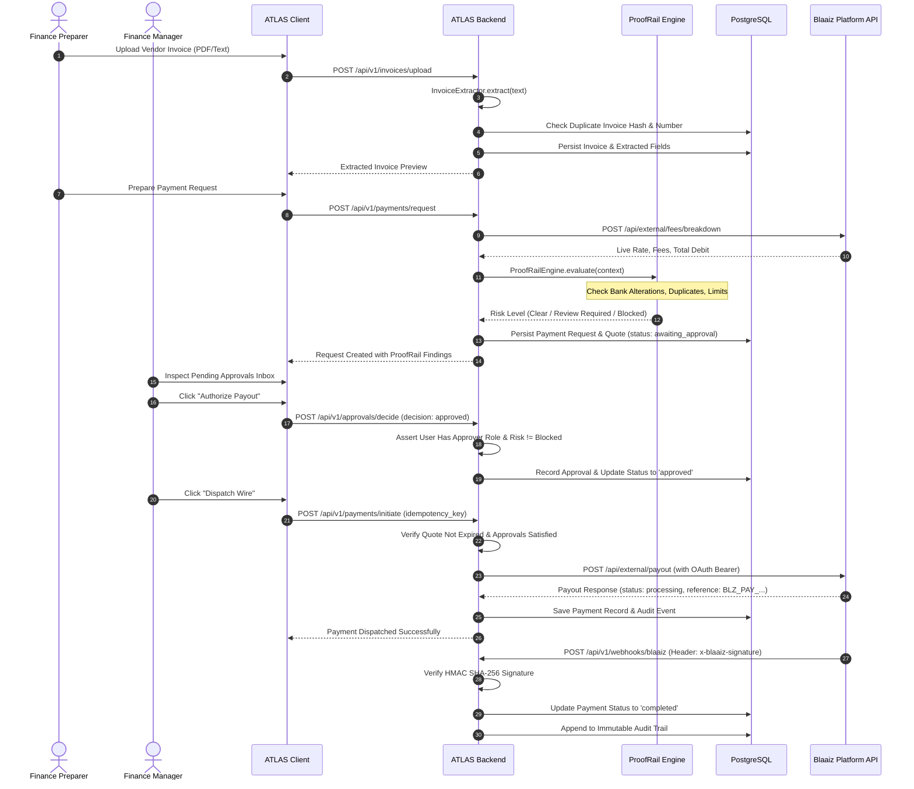

# SYSTEM ARCHITECTURE — ATLAS PLATFORM

This document specifies the technical architecture, data flow patterns, component boundaries, and provider integration model for **ATLAS**.

---

## 1. High-Level Architecture Overview

ATLAS connects international commerce, risk controls, and fiat payment rails into a single platform:

```
+-----------------------------------------------------------------------------------------+
|                                    CLIENT BROWSER                                       |
|  React 19 + TypeScript + Vite + Tailwind CSS v4                                         |
|  - Overview Dashboard      - Invoices Workspace       - ProofRail Control Center        |
|  - Supplier Directory      - Relay Payments Terminal  - Multi-Step Approval Inbox       |
+-----------------------------------------------------------------------------------------+
                                      |  REST API & JSON
                                      v
+-----------------------------------------------------------------------------------------+
|                                  ATLAS BACKEND SERVICE                                  |
|  Node.js 22 + TypeScript + Express.js (Port: 3007)                                      |
|                                                                                         |
|  +-----------------------+  +------------------------+  +----------------------------+  |
|  |   ATLAS COMMERCE      |  |    PROOFRAIL TRUST     |  |       RELAY PAYMENTS       |  |
|  | - Org Data Isolation  |  | - Deterministic Rules  |  | - Blaaiz Provider Adapter  |  |
|  | - Supplier Records    |  | - Recipient Change Pro |  | - FX Rate & Fee Engine     |  |
|  | - Invoice OCR Parser  |  | - Policy Limits Gate   |  | - Payout Idempotency Keys  |  |
|  | - Manual Review Form  |  | - Role Authorizations  |  | - Webhook Verifier (HMAC)  |  |
|  +-----------------------+  +------------------------+  +----------------------------+  |
|                                                                                         |
|  +-----------------------------------------------------------------------------------+  |
|  | Append-Only Immutable Audit Engine & Background Reconciliation Worker             |  |
|  +-----------------------------------------------------------------------------------+  |
+-----------------------------------------------------------------------------------------+
                  |                                                  |
                  | SQL Queries & Transactions                       | OAuth2 & Signed Webhooks
                  v                                                  v
+------------------------------------+           +----------------------------------------+
|       POSTGRESQL DATABASE          |           |        BLAAIZ PLATFORM API             |
|  - Multi-Tenant Schema             |           |  - Sandbox: api-dev.blaaiz.com         |
|  - Precision Minor Units           |           |  - Production: api-prod.blaaiz.com     |
|  - Referential Integrity           |           |  - OAuth 2.0 Client Credentials        |
|  - Append-Only Event Ledger        |           |  - Bank Transfers & Live FX Rates      |
+------------------------------------+           +----------------------------------------+
```

---

## 2. End-to-End Payout Lifecycle Sequence

The sequence diagram below illustrates how an invoice is uploaded, verified by ProofRail, authorized by human approvers, and dispatched through Blaaiz:



---

## 3. The Blaaiz Provider Adapter Pattern

To isolate external API dependencies, all communications with Blaaiz pass through the `BlaaizClient` abstraction layer (`backend/src/blaaiz/client.ts`):

1. **OAuth 2.0 Token Manager**:
   - Manages token exchange via `POST /oauth/token` using `grant_type=client_credentials`.
   - Caches the Bearer token in memory and renews it 60 seconds prior to expiration.
   - Enforces specific scopes: `payout:create`, `fees:read`, `currency:read`, `wallet:read`.
2. **Fee & Rate Calculator**:
   - Queries `POST /api/external/fees/breakdown` to fetch explicit fee breakdowns (0.35% + flat charge + 7.5% VAT).
   - Queries `GET /api/external/rates` for current multi-currency FX tables.
3. **Payout Gateway**:
   - Submits `POST /api/external/payout` with client-generated idempotency keys.
4. **Sandbox Emulator Fallback**:
   - When credentials are not supplied or the sandbox is offline, the client seamlessly routes to `BlaaizSandboxEmulator` which implements the exact same API contract and data shapes.

---

## 4. Multi-Tenant Organisation Data Isolation

Every domain entity in PostgreSQL includes an explicit `organisation_id` foreign key:
- `suppliers`
- `recipients`
- `invoices`
- `payment_requests`
- `payments`
- `payment_audit_events`

All API endpoints strictly filter queries by the authenticated user's `organisation_id`, ensuring tenant private data is never leaked or accessible cross-tenant.

---

## 5. Append-Only Financial Immutability

The `payment_audit_events` and `payment_provider_events` tables are architected as write-once append-only ledgers:
- Database privileges prevent `UPDATE` or `DELETE` operations.
- State transitions (approval, rejection, payout initiation, webhook delivery) are permanently logged with timestamps, actor IDs, roles, and JSON payloads.

