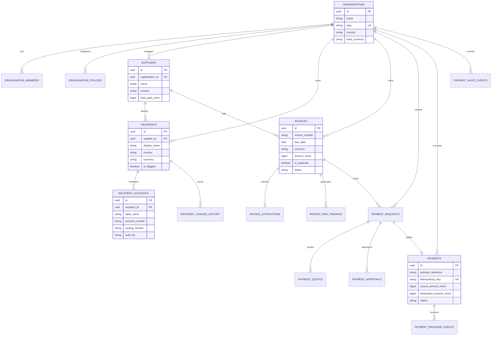

# DATABASE SCHEMA & ENTITY RELATIONSHIP MODEL — ATLAS

This document details the PostgreSQL relational schema, entity relationships, constraints, indexes, and immutability controls implemented in **ATLAS**.

---

## 1. Entity-Relationship Diagram



---

## 2. Table Definitions & Constraints

### 2.1 `organisations` & `organisation_policies`
- **Tenant Isolation**: Every enterprise has a distinct UUID.
- **Policies**: Enforces `max_single_payment_minor`, `max_daily_payment_minor`, and `dual_approval_threshold_minor`.

### 2.2 `invoices` & `invoice_extractions`
- **Duplicate Prevention**: `UNIQUE (organisation_id, invoice_number, supplier_id)`.
- **Integrity**: `file_hash VARCHAR(64)` storing SHA-256 digest of invoice content to identify re-uploads immediately.

### 2.3 `recipient_change_history` (ProofRail Protection)
- Captures old vs new account JSON whenever bank routing numbers are modified.
- Linked to `users(id)` to establish an unforgeable change attribution trail.

### 2.4 `payments`
- **Idempotency Guarantee**: `idempotency_key VARCHAR(100) UNIQUE NOT NULL`.
- **State Constraint**: `status IN ('processing', 'completed', 'failed', 'cancelled', 'requires_reconciliation')`.

### 2.5 `payment_audit_events` (Append-Only)
- Records all actions (`invoice_uploaded`, `bank_details_changed`, `risk_evaluated`, `payment_approved`, `payout_initiated`, `reconciliation_completed`).
- `metadata JSONB` captures snapshot details for auditing.

---

## 3. High-Frequency Index Strategy

```sql
CREATE INDEX idx_members_org_user ON organisation_members(organisation_id, user_id);
CREATE INDEX idx_suppliers_org ON suppliers(organisation_id);
CREATE INDEX idx_recipients_org ON recipients(organisation_id);
CREATE INDEX idx_recipient_accounts_recipient ON recipient_accounts(recipient_id);
CREATE INDEX idx_invoices_org ON invoices(organisation_id);
CREATE INDEX idx_invoices_hash ON invoices(file_hash);
CREATE INDEX idx_payments_org ON payments(organisation_id);
CREATE INDEX idx_payments_status ON payments(status);
CREATE INDEX idx_payments_idempotency ON payments(idempotency_key);
CREATE INDEX idx_payments_ref ON payments(provider_reference);
CREATE INDEX idx_audit_org_created ON payment_audit_events(organisation_id, created_at DESC);
```
Enables sub-millisecond query performance on dashboard aggregates and risk monitoring filters.

